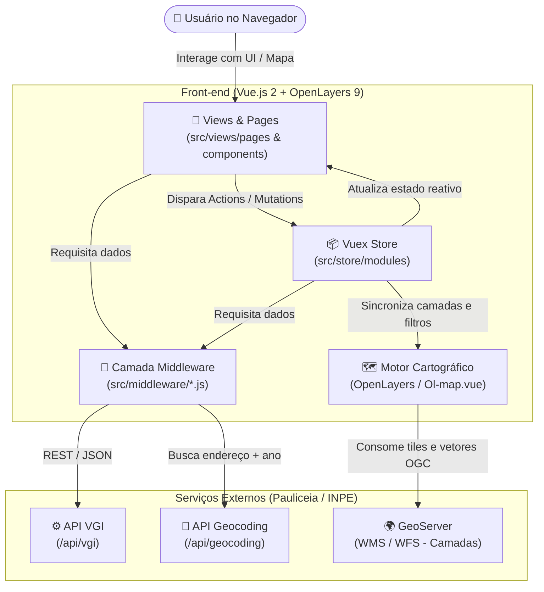

# Arquitetura e Estrutura do Projeto — Pauliceia 2.0 (Front-end)

Este documento apresenta uma visão geral da arquitetura, organização de diretórios e fluxo de dados do portal front-end da plataforma **Pauliceia 2.0**.

---

## 🏗️ Visão Geral da Stack Tecnológica

A aplicação é uma **Single Page Application (SPA)** construída sobre o ecossistema Vue.js e ferramentas especializadas em WebGIS (Sistemas de Informação Geográfica para Web):

| Camada | Tecnologia | Versão | Papel na Aplicação |
| :--- | :--- | :--- | :--- |
| **Framework UI** | Vue.js | `^2.7.16` | Renderização reativa de componentes e páginas |
| **Gerenciamento de Estado** | Vuex | `^3.6.2` | Estado global (autenticação, camadas ativas, edições no mapa) |
| **Roteamento** | Vue Router | `^3.6.5` | Navegação SPA entre mapa interativo, painel e páginas institucionais |
| **Motor Cartográfico** | OpenLayers (`ol`) | `^9.2.4` | Renderização de mapas, camadas vetoriais/raster, projeções e feições |
| **Cliente HTTP** | Axios | `^1.7.7` | Comunicação assíncrona com a API VGI, API de Geocodificação e GeoServer |
| **Internacionalização** | Vue I18n / Vuex I18n | `^8.28.2` | Suporte multilíngue (Português e Inglês) |
| **Componentes Visuais** | Element UI, Vue Material, Bootstrap 5 | — | Modais, tabelas, formulários, barras laterais e controles de interface |
| **Empacotador (Bundler)** | Webpack | `^5.94.0` | Build, minificação, *hot-reload* e pré-renderização |

---

## 📂 Estrutura de Diretórios

```text
pauliceia/
├── build/                  # Scripts de empacotamento e configuração do Webpack (dev e prod)
├── config/                 # Variáveis de ambiente e URLs de serviços externos (prod.env.js)
├── docs/                   # Documentação técnica do repositório
├── src/                    # Código-fonte principal da aplicação
│   ├── middleware/         # Camada de serviços HTTP e integração com APIs externas
│   ├── router/             # Definição de rotas e guardas de navegação
│   ├── store/              # Estado centralizado do Vuex (módulos e persistência)
│   ├── views/              # Camada de apresentação (componentes, páginas, layouts e idiomas)
│   ├── App.vue             # Componente raiz da aplicação
│   └── main.js             # Ponto de entrada (inicialização do Vue, plugins e OpenLayers global)
├── static/                 # Arquivos estáticos públicos servidos diretamente
├── .editorconfig           # Padronização de formatação entre editores
├── eslint.config.js        # Regras de análise estática e linting (ESLint 9)
├── CONTRIBUTING.md         # Guia de contribuição e padrões de nomenclatura
└── package.json            # Manifesto de dependências e scripts NPM
```

---

## 🧩 Detalhamento dos Módulos (`src/`)

### 1. `src/middleware/` — Comunicação com APIs e Serviços Geográficos
Centraliza todas as chamadas HTTP externas utilizando `axios`, isolando a lógica de rede dos componentes visuais:
- **`ApiVGI.js`**: Instância e chamadas para a API de *Volunteered Geographic Information* (gerenciamento de camadas, usuários, atributos e dados colaborativos).
- **`ApiGeocoding.js`**: Integração com o motor de geocodificação histórica (busca de endereços históricos de São Paulo por logradouro, número e ano).
- **`Map.js`**: Requisições voltadas à manipulação e consulta de camadas geográficas e feições.
- **`Edit.js`**: Operações de criação, edição e exclusão de geometrias e vetores nas camadas colaborativas.
- **`Dashboard.js`**: Serviços de apoio ao painel administrativo do usuário (upload de CSV/Shapefile, metadados de camadas, palavras-chave).
- **`User.js`**: Autenticação, cadastro, perfil e validação de sessão/redes sociais.

### 2. `src/store/` — Gerenciamento de Estado (Vuex)
Gerencia o estado compartilhado entre múltiplos componentes da tela (como a barra lateral do mapa, a linha do tempo e o canvas do OpenLayers), contando com persistência local via `vuex-persistedstate`:
- **`modules/auth.js`**: Sessão do usuário logado, tokens e permissões.
- **`modules/map.js`**: Controle de camadas visíveis, opacidade, filtro temporal (slider de anos), geocodificação e popups de feições.
- **`modules/edit.js`**: Estado das ferramentas de desenho e edição vetorial ativa no mapa.
- **`modules/dashboard.js` & `modules/dashboardNewLayer.js`**: Estado dos fluxos de criação e gerenciamento de camadas no painel do colaborador.

### 3. `src/router/` — Navegação (Vue Router)
Divide as rotas da aplicação em contextos claros:
- **`map.js`**: Rota principal de exploração cartográfica (`/explore`).
- **`dashboard.js`**: Rotas autenticadas do painel do colaborador (gerenciamento de camadas, criação de nova camada, perfil).
- **`routes.js` & `index.js`**: Páginas institucionais (`/home`, `/about`, `/tutorial`, `/contact`, `/login`, `/register`) e configuração do roteador.

### 4. `src/views/` — Interface de Usuário e Internacionalização
- **`layouts/`**: Estruturas base da interface (`application.vue` para o portal geral/mapa e `dashboard.vue` para a área restrita do usuário).
- **`pages/`**: Componentes de página vinculados diretamente às rotas (`home.vue`, `explore.vue`, `about.vue`, `tutorial.vue`, `login.vue`, etc.).
- **`components/`**:
  - `map/`: Componentes geográficos acoplados ao OpenLayers (`Ol-map.vue`, `Timeline.vue`, controles de camadas, legenda, busca de endereços e geocodificação).
  - `aside-right/`: Painéis laterais retráteis de atributos, camadas e ferramentas.
  - `dashboard/`: Componentes de formulários e tabelas do painel do usuário.
- **`language/`**: Dicionários de tradução (`translations/`) para suporte aos idiomas Português e Inglês.

---

## 🔄 Fluxo de Dados e Arquitetura de Interação

O diagrama abaixo ilustra como uma ação do usuário (como buscar um endereço histórico ou ativar uma camada temporal) percorre a arquitetura do front-end até os servidores da plataforma:



---

## ⚙️ Configuração de Serviços (`config/`)

A conexão do front-end com os serviços de back-end é parametrizada no arquivo `config/prod.env.js` (criado a partir de `config/prod.env.js.EXAMPLE`):

- `urlVGI`: Endpoint base da API REST de dados colaborativos (VGI).
- `urlGeocoding`: Endpoint da API de geocodificação histórica.
- `urlGeoserverPauliceia`: Servidor GeoServer responsável pelas camadas históricas oficiais e colaborativas do projeto.
- `urlGeoserveOther`: Workspace auxiliar do GeoServer para camadas complementares.
- `keyCripto`: Chave utilizada para rotinas de verificação/hash no cliente.
